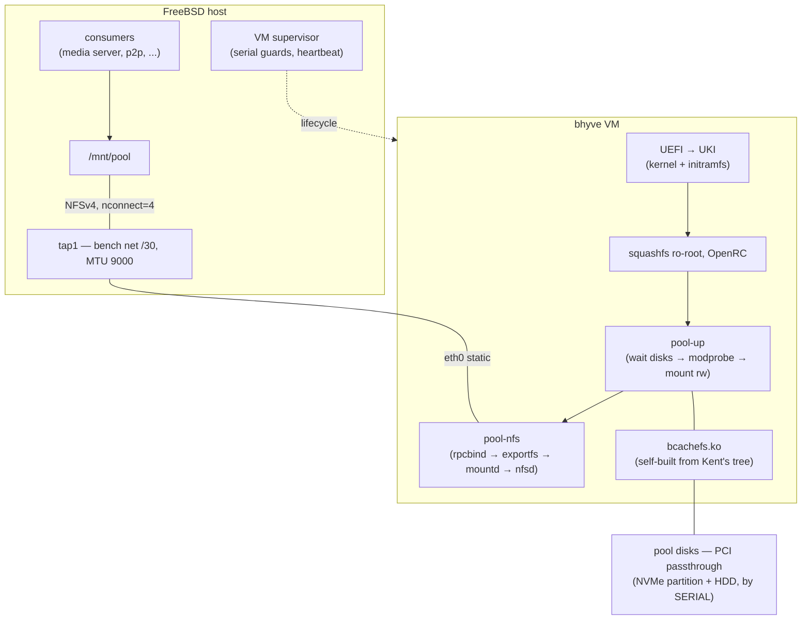

# bcachefs-box

**Run a bcachefs storage pool inside a Linux appliance VM on FreeBSD bhyve — and serve it back to the host over NFSv4.**

An immutable, reproducible guest image in the spirit of
[pgj/freebsd-wifibox](https://github.com/pgj/freebsd-wifibox): the host owns the
lifecycle, the guest is a sealed 163 MB squashfs appliance with exactly one job —
keep your bcachefs pool mounted and exported.

Built and proven on a real 4.4 TB two-member pool (NVMe + HDD) as an
alternative stack to the bcachefs FUSE port.

## Why

- bcachefs is not in the FreeBSD kernel (the FUSE port is a separate effort).
  A bhyve guest with PCI passthrough of the pool disks is a proven bridge.
- Hand-installed Linux guests rot: config drift, getty storms, ps2 floods.
  The appliance model (image built from a recipe, read-only root, services as
  an explicit list) removes that entire class — an upgrade is an atomic image
  swap plus a VM reboot.
- The kernel module is **always built from Kent Overstreet's source tree**
  (never a distro package), pinned explicitly. See *Version policy*.
- The host bridge choice (NFSv4 over 9p/sshfs) is a measured comparison,
  not a default: [docs/bridge-comparison.md](docs/bridge-comparison.md).

## Architecture



## Proven on real hardware (2026-11 alpha run)

| Claim | Evidence |
|---|---|
| Full chain alive | UKI → squashfs → OpenRC → pool-up (2-member, rw) → NFSv4 → host consumers |
| Throughput | 158 MB/s single-stream read through the whole stack |
| Soak | 8+ h, 6M+ NFS RPCs, **0 timeouts / 0 retries** (10-min metric samples all green) |
| Resilience | survived a host root-fs-full incident mid-soak without a scratch |
| Self-healing | pool recovered from an accidental dual-writer window: 6 recovery passes, ~7.5 h, damage = 2 checksum errors, zero data loss |
| Cold start | full stack back after a host reboot in a 3-minute ceremony |

Full story with the incident write-up: [docs/ALPHA-RUN-REPORT.md](docs/ALPHA-RUN-REPORT.md).

## Repository layout

```
host/                      FreeBSD host side
  run-bcachefsbox.sh       VM supervisor: declarative conf, serial guards, heartbeat
  bhyve-vm.conf.example    sanitized VM config (disk slots, bench-net tap)
image/                     guest image recipe
  kmod-build.sh            bcachefs.ko from Kent's tarball, against linux-lts headers
  initrd/init              busybox initramfs (virtio + squashfs only)
  overlay/etc/             files baked into the squashfs root
    init.d/pool-up         OpenRC: wait disks → modprobe bcachefs → mount rw
    init.d/pool-nfs        OpenRC: rpcbind (foreground) → exportfs → mountd → nfsd
    network/interfaces     static bench-net IP, MTU 9000 (see findings F24!)
    fstab, modules, ...
docs/                      run reports: spike, module, NFS plane, alpha run,
                           drain-bug archaeology (why the version floor exists)
```

## Building the image

Three stages; stages 1–2 use a throwaway Linux builder (any Debian VM or
chroot; an Alpine chroot inside the builder for musl-exact tooling).

1. **Kernel module** — Kent's tarball, staged `dkms/Makefile` build
   (never build from the tarball root: it drags in cargo):
   ```sh
   # inside the Alpine chroot, headers = exactly your appliance kernel
   sh image/kmod-build.sh     # → bcachefs.ko, vermagic-exact
   ```
   Deps leaf-set + env quirks are documented in the script header (F14–F20).

2. **Root filesystem** — Alpine minirootfs unpacked on the host, then in the
   builder: `apk add openrc nfs-utils-openrc rpcbind-openrc` (init scripts live
   in `-openrc` subpackages!), overlay `image/overlay/`, the module into the
   full `/lib/modules` tree, `mksquashfs`.

3. **Boot** — slim initramfs (virtio+squashfs only) packed as **newc by GNU
   cpio** (FreeBSD cpio newc is not kernel-accepted — F12), `ukify` into a UKI,
   written to a FAT ESP.

> Variant B (wifibox-verbatim, described not shipped): a custom kernel with
> virtio+squashfs+bcachefs built `=y` — then `vmlinuz` **is** `bootx64.efi`,
> no initramfs, no ukify, and the whole image can be built host-side with
> `tar2sqfs` + mtools like freebsd-wifibox-alpine does.

## Running

```sh
# one-time: edit host/bhyve-vm.conf.example → /vm/bcachefs-box/bhyve-vm.conf
#           put YOUR disk serials in the supervisor's guards
doas service bcachefsbox onestart       # VM boots, pool-up mounts, pool-nfs exports

# host side:
doas mount -t nfs -o nfsv4,nconnect=4 172.31.255.2:/pool /mnt/pool
```

After a host reboot (bring-up ceremony): start VM → mount → consumers.
`rpc.statd` is deliberately omitted (NFSv4 has no NSM/NLM); `rpcbind` is
spawned in the foreground by `pool-nfs` — busybox `start-stop-daemon`
silently kills daemonizing rpcbind (F22).

## Version policy (read before touching pools)

- **Always build the module from Kent's tree**, pin the version explicitly.
  Distros lag; the on-disk format is a one-way ratchet.
- **Floor = 1.39** for pools created/upgraded by 1.39-era stacks
  (`per_dev_fragmentation_lru` — the fix for the reconcile/copygc deadlock;
  see [docs/DRAIN-ARCHAEOLOGY.md](docs/DRAIN-ARCHAEOLOGY.md)).
- bcachefs left the Linux mainline between v6.17 and v6.18 — on 6.18+ the
  module is out-of-tree **by necessity**, not by choice (F15).
- A `rw` mount by version N ratchets the on-disk format to N: older stacks
  will refuse the pool afterwards. Scratch pools are self-consistent per build.

## Scars worth reading before your own run

| # | Finding |
|---|---|
| F12 | FreeBSD cpio `newc` ≠ kernel-accepted newc; initramfs via GNU cpio |
| F13 | Alpine minirootfs busybox is dynamically linked — ship `ld-musl` |
| F17 | squashfs ro-root: bake mountpoints into the image |
| F22 | rpcbind dies under busybox s-s-d; spawn foreground in your own unit |
| F24 | **MTU parity host↔guest** — a mismatch shows up as unkillable `mount_nfs` reconnect zombies holding a per-server lock (diagnose with `tcpdump` + `procstat -k`, never by re-trying the mount) |
| F26 | quiesce inventories: `service -e`, not selective greps — a hidden watchdog re-raised a FUSE mount on top of the VM's disks → dual-writer → 7.5 h recovery |

Full index in the docs/ reports.

## Credits

- [pgj/freebsd-wifibox](https://github.com/pgj/freebsd-wifibox) and
  [freebsd-wifibox-alpine](https://github.com/pgj/freebsd-wifibox-alpine) —
  the appliance pattern, the Alpine image pipeline this project borrows from.
- [koverstreet/bcachefs](https://github.com/koverstreet/bcachefs) — the
  filesystem and the kernel module source of truth.

## Status

Experiment concluded viable (2026-11); archived as a reference recipe.
Production went the bcachefs-FUSE-port route — this stack remains a proven
fallback/DR path and a benchmark platform.
