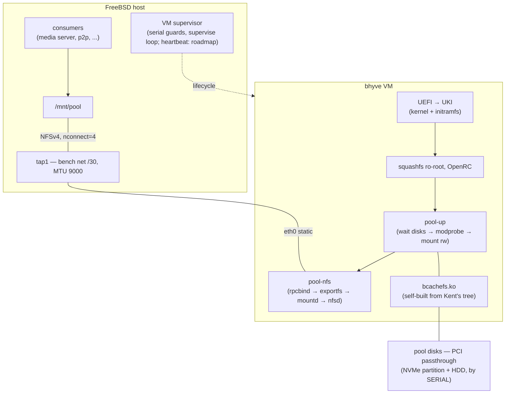

# bcachefs-box

**Run a bcachefs storage pool inside a Linux appliance VM on FreeBSD bhyve — and serve it back to the host over NFSv4.**

An immutable, reproducible guest image in the spirit of
[pgj/freebsd-wifibox](https://github.com/pgj/freebsd-wifibox): the host owns the
lifecycle, the guest is a sealed 163 MB squashfs appliance with exactly one job —
keep your bcachefs pool mounted and exported.

The host and the guest talk over a dedicated point-to-point link (the
"bench net", 172.31.255.0/30 over a tap interface): NFSv4 for the data plane,
the serial console for everything else. No guest SSH by design — the appliance
has one job and no interactive surface beyond the host-gated console.

Built and proven on a real 4.4 TB two-member pool (NVMe + HDD) as an
alternative stack to the bcachefs FUSE port.

## Why

- bcachefs is not in the FreeBSD kernel (the FUSE port is a separate effort).
  A bhyve guest with PCI passthrough of the pool disks is a proven bridge.
- Hand-installed Linux guests rot: config drift, getty storms, ps2 floods.
  The appliance model (image built from a recipe, read-only root, services as
  an explicit list) removes that entire class — an upgrade is an atomic image
  swap plus a VM reboot.
- The kernel module is **always built from Kent Overstreet's source tree**
  (never a distro package), pinned explicitly. See *Version policy*.
- The host bridge choice (NFSv4 over 9p/sshfs) is a measured comparison,
  not a default: [docs/bridge-comparison.md](docs/bridge-comparison.md).

## Architecture



**Pool-disk guards.** Before every VM start the supervisor asserts each
passthrough path's device serial against the serials of the production pool
disks (the NVMe member and the HDD member) recorded in the lifecycle config,
and refuses to start the VM on any mismatch. Devices are identified by
slot + serial, never by name — `ada*`/`nda*` naming shifts with driver probe
order, and a wrong-name `dd` is exactly the accident class this guard exists
to prevent. Put your own disk serials into the guards before first start
(see *Running*).

## Proven on real hardware (2026-11 alpha run)

| Claim | Evidence |
|---|---|
| Full chain alive | UKI → squashfs → OpenRC → pool-up → NFSv4 → host consumers — rehearsal console: [docs/evidence/console-alpine-poolup.log](docs/evidence/console-alpine-poolup.log) |
| Throughput | **two stands, not comparable — never averaged:** appliance stand single-stream spot-read 3 MiB / 0.0198 s ≈ 159 MB/s through the full stack (incl. host NFS client); bridge-bench stand 570 MB/s seq-read (dd 1 GiB, cold, MTU 9000) — [docs/bridge-comparison.md](docs/bridge-comparison.md) |
| Soak | overnight, 43 × 10-min samples all green: `nfs_err_delta=0` in every sample (no timeouts / no retransmits), NFS client RPC counter 77k → 10.1M — [docs/evidence/soak-metrics.tsv](docs/evidence/soak-metrics.tsv) |
| Resilience | survived a host root-fs-full incident mid-soak without a scratch (the 7.5 h sampler gap in the soak file sits in that window; no dedicated incident write-up was preserved) |
| Self-healing | pool recovered from an accidental dual-writer window: 6 recovery passes, ~7.5 h, damage = 2 checksum errors, zero data loss |
| Cold start | one-script bring-up — [host/pool-stack-up.sh](host/pool-stack-up.sh): `service bcachefsbox onestart` → grace wait → NFS mount → sanity check; back after a host reboot without a rebuild |

Arithmetic note: 3 MiB = 3,145,728 B; 3 MiB / 0.0198 s = 158.9 MB/s
(decimal MB/s). Earlier notes showing "151.5 MB/s" divided 3,000,000 B —
the measurement is the same, the unit convention wasn't. "158" elsewhere
in the docs is this same number, truncated.

Full story with the incident write-up: [docs/alpha-run.md](docs/alpha-run.md).
Committed evidence (sanitized console captures + soak metrics):
[docs/evidence/](docs/evidence/).

## Repository layout

```
host/                      FreeBSD host side
  run-bcachefsbox.sh       VM supervisor: declarative conf, serial guards, supervise loop
  pool-stack-up.sh         cold-start ceremony: rc.d onestart → NFS mount → sanity check
  rc.d/bcachefsbox         rc.d wrapper (one-time copy to /usr/local/etc/rc.d/)
  bhyve-vm.conf.example    sanitized VM config (disk slots, bench-net tap)
image/                     guest image recipe
  kmod-build.sh            bcachefs.ko from Kent's tarball, against linux-lts headers
  initrd/init              busybox initramfs (virtio + squashfs only)
  overlay/etc/             files baked into the squashfs root
    init.d/pool-up         OpenRC: wait disks → modprobe bcachefs → mount rw
    init.d/pool-nfs        OpenRC: rpcbind (foreground) → exportfs → mountd → nfsd
    network/interfaces     static bench-net IP, MTU 9000 (see findings F24!)
    fstab, modules, ...
docs/                      run reports (spike, module, NFS plane, alpha run,
                           drain-bug archaeology — why the version floor exists),
                           FINDINGS.md (full findings index), host/README.md
                           (host prerequisites: bridge/tap, rc.conf, doas),
                           evidence/ (sanitized console captures, soak metrics)
```

## Building the image

Three stages; stages 1–2 use a throwaway Linux builder (any Debian VM or
chroot; an Alpine chroot inside the builder for musl-exact tooling).

1. **Kernel module** — Kent's tarball, staged `dkms/Makefile` build
   (never build from the tarball root: it drags in cargo):
   ```sh
   # inside the Alpine chroot, headers = exactly your appliance kernel
   sh image/kmod-build.sh     # → bcachefs.ko, vermagic-exact
   ```
   Deps leaf-set + env quirks are documented in the script header (F14–F20).

2. **Root filesystem** — Alpine minirootfs unpacked on the host, then in the
   builder: `apk add openrc nfs-utils-openrc rpcbind-openrc` (init scripts live
   in `-openrc` subpackages!), overlay `image/overlay/`, the module into the
   full `/lib/modules` tree, `mksquashfs`.

3. **Boot** — slim initramfs (virtio+squashfs only) packed as **newc by GNU
   cpio** (FreeBSD cpio newc is not kernel-accepted — F12), `ukify` into a UKI,
   written to a FAT ESP.

> Variant B (wifibox-verbatim, described not shipped): a custom kernel with
> virtio+squashfs+bcachefs built `=y` — then `vmlinuz` **is** `bootx64.efi`,
> no initramfs, no ukify, and the whole image can be built host-side with
> `tar2sqfs` + mtools like freebsd-wifibox-alpine does.

## Running

```sh
# one-time: host prerequisites (bridge/tap, rc.conf, doas rules): host/README.md
#           edit host/bhyve-vm.conf.example → /vm/bcachefs-box/bhyve-vm.conf
#           put YOUR disk serials in the supervisor's guards
doas service bcachefsbox onestart       # VM boots, pool-up mounts, pool-nfs exports

# host side:
doas mount -t nfs -o nfsv4,nconnect=4 172.31.255.2:/pool /mnt/pool
```

After a host reboot, run the whole bring-up as one script:
`doas sh host/pool-stack-up.sh` (start VM → grace wait → NFS mount →
sanity check), then start consumers as needed.
`rpc.statd` is deliberately omitted (NFSv4 has no NSM/NLM); `rpcbind` is
spawned in the foreground by `pool-nfs` — busybox `start-stop-daemon`
silently kills daemonizing rpcbind (F22).

## Version policy (read before touching pools)

- **Always build the module from Kent's tree**, pin the version explicitly.
  Distros lag; the on-disk format is a one-way ratchet.
- **Floor = 1.39** for pools created/upgraded by 1.39-era stacks
  (`per_dev_fragmentation_lru` — the fix for the reconcile/copygc deadlock;
  see [docs/version-floor.md](docs/version-floor.md)).
- bcachefs left the Linux mainline between v6.17 and v6.18 — on 6.18+ the
  module is out-of-tree **by necessity**, not by choice (F15).
- A `rw` mount by version N ratchets the on-disk format to N: older stacks
  will refuse the pool afterwards. Scratch pools are self-consistent per build.

## Scars worth reading before your own run

| # | Finding |
|---|---|
| F12 | FreeBSD cpio `newc` ≠ kernel-accepted newc; initramfs via GNU cpio |
| F13 | Alpine minirootfs busybox is dynamically linked — ship `ld-musl` |
| F17 | squashfs ro-root: bake mountpoints into the image |
| F22 | rpcbind dies under busybox s-s-d; spawn foreground in your own unit |
| F24 | **MTU parity host↔guest** — a mismatch shows up as unkillable `mount_nfs` reconnect zombies holding a per-server lock (diagnose with `tcpdump` + `procstat -k`, never by re-trying the mount) |
| F26 | quiesce inventories: `service -e`, not selective greps — a hidden watchdog re-raised a FUSE mount on top of the VM's disks → dual-writer → 7.5 h recovery |

Full index: [docs/FINDINGS.md](docs/FINDINGS.md).

## Credits

- [pgj/freebsd-wifibox](https://github.com/pgj/freebsd-wifibox) and
  [freebsd-wifibox-alpine](https://github.com/pgj/freebsd-wifibox-alpine) —
  the appliance pattern, the Alpine image pipeline this project borrows from
  (BSD-2-Clause; ported helpers attributed in [NOTICE](NOTICE)).
- [koverstreet/bcachefs](https://github.com/koverstreet/bcachefs) — the
  filesystem and the kernel module source of truth.

## License & attribution

This repository's code is ISC — see [LICENSE](LICENSE). [NOTICE](NOTICE)
covers the rest: the supervisor ports two helper groups from
freebsd-wifibox (BSD-2-Clause, © Páli Gábor János), and built artifacts
(`bcachefs.ko`, bcachefs-tools) are GPL-2.0-only from Kent's tree and are
not covered by this repo's license.

## Status

Experiment concluded viable (2026-11); archived as a reference recipe.
Production went the bcachefs-FUSE-port route — this stack remains a proven
fallback/DR path and a benchmark platform.

Roadmap (not shipped): the guest→host heartbeat over the status share is
designed and appears in rehearsal console captures
([docs/evidence/](docs/evidence/)), but is **not** part of the committed
guest overlay. The shipped supervision story is the supervisor's serial
guards plus the bhyve exit-status supervise loop, nothing more.
